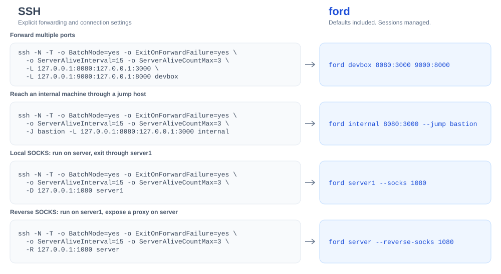

# ford

## Why ford?

One CLI for remote ports, jump hosts, and outbound proxies. Short commands, with session management built in.



The SSH examples spell out forwarding, noninteractive authentication, and keepalive settings that ford supplies
by default. ford also gives you named background sessions, logs, bounded retries, and saved groups.

Only SSH needs to be reachable. Keep your app's port private; no ford installation is needed on the SSH server.

## Highlights

- **Port forwarding:** map one or several remote TCP ports to local ports of your choice.
- **Jump hosts:** reach internal machines through a bastion with `--jump` / `-J`.
- **SOCKS in both directions:** send selected requests through another machine, even when it must connect back to you.
- **Managed sessions:** named background tunnels, foreground mode, logs, JSON output, and explicit shutdown.
- **Saved groups:** save a set of mappings and restore them with one command.
- **Bounded reconnection:** opt into retries with increasing delays; cancel them with `close` or Ctrl+C.
- **Fits your SSH setup:** reuse aliases, keys, agents, and known hosts. One Rust executable, using system OpenSSH.
- **Self-updates:** install the latest stable release with `ford update`, with checksum verification.

## Install

Linux and macOS, x86_64 and ARM64. Requires OpenSSH 7.6 or newer and an SSH server that allows TCP forwarding.

```bash
curl -fsSL https://raw.githubusercontent.com/Marukohe/ford/main/scripts/install.sh | sh
```

Installs the latest release to `~/.local/bin`, verifies its checksum, and configures PATH for Bash or zsh.
Open a new terminal or run the activation command printed by the installer. Run the same command to upgrade.
On Linux it automatically selects a static musl binary, avoiding a dependency on your system's glibc version.
GNU binaries remain available for manual download or with `sh scripts/install.sh --libc gnu`.

[Manual downloads](https://github.com/Marukohe/ford/releases) are also available. To build the current source with Rust:

```bash
git clone https://github.com/Marukohe/ford.git
cd ford
cargo install --path . --locked
```

First confirm that `ssh user@server` works with a key or agent and a trusted host key.
ford does not prompt for passwords.

## Update

```bash
ford update --check   # Check for a newer stable release
ford update           # Download, verify, and replace the current executable
```

Updates preserve your installation directory, PATH settings, and running sessions. The directory must be writable;
ford does not request administrator access. Requires `curl`, `tar`, and `sha256sum` or `shasum`.
Download and verification failures leave the existing binary in place. Current or newer versions are not reinstalled.

## Forward ports

Use `LOCAL:REMOTE`, or a single number for the same port on both machines:

```bash
ford devbox 3000                              # localhost:3000 -> devbox:3000
ford devbox 8080:3000 --name web               # localhost:8080 -> devbox:3000
ford devbox 3000 5173 8080:8000 --name dev      # Several ports, one session
ford internal 8080:3000 --jump bastion         # SSH through bastion into internal
```

Fixed mappings connect to `127.0.0.1` on the remote machine. Local listeners bind to `127.0.0.1`.
Use SSH configuration for login ports and identities; jump hosts also accept `user@host:port`.

## Proxy outbound requests

Choose the direction that matches your SSH access:

```bash
# Run on server: requests exit through server1
ford server1 --socks 1080 --name outbound --retry

# Alternatively, run on server1: expose a proxy on server, with egress through server1
ford server --reverse-socks 1080 --name outbound --retry
```

In either case, run selected requests **on server**:

```bash
curl --proxy socks5h://127.0.0.1:1080 https://example.com
```

`socks5h` also resolves destination hostnames on the exit machine. Only applications using the proxy are affected.
Manage the session on the machine where you launched ford. Both modes support jump hosts, groups, and retries;
repeat the options for more ports or combine them with fixed mappings.

Reverse SOCKS requires OpenSSH 7.6 or newer on the machine running ford, and remote TCP forwarding permission.
The SSH server must use
`GatewayPorts no` or `clientspecified`; `yes` overrides loopback binding. ford cannot verify that remote policy.
See [OpenSSH's GatewayPorts documentation](https://man.openbsd.org/sshd_config#GatewayPorts).

## Save mapping groups

```bash
ford group save work web dev       # Save existing sessions, including their jump and retry settings
ford group close work
ford group open work               # Restore the group; skip matching active sessions
ford group list
ford group show work
ford group remove work             # Remove the saved group; leave sessions running
```

Use `group save work --all --force` to replace a group with all running or retrying sessions. Groups retain fixed and
SOCKS mappings, survive restarts, and leave unrelated sessions alone. Resolve name or port conflicts before reopening.

## Reconnect automatically

```bash
ford devbox 8080:3000 --name web --retry       # Up to five SSH restarts
ford devbox 8080:3000 --name web --retry=10    # Choose a lifetime limit from 0 to 100
```

Retries are off by default. Delays grow from 1, 2, 4, 8, 16 to 30 seconds, capped at 30 seconds. `ford list` shows
`retrying` between attempts. The budget does not reset after recovery; errors remain in logs, and exhaustion ends the
session. `close` or foreground Ctrl+C cancels retries. Existing TCP/WebSocket connections must reopen after recovery.
Logs identify the supervisor version, SSH executable, and arguments for every attempt, including retries.

## Manage and check sessions

```bash
ford list                         # Current sessions; add --all for history or --json for scripts
ford logs web                     # Recent SSH diagnostics
ford check web --http / --expect-status 200
ford close web                    # Also accepts a session ID or unique ID prefix
ford close --all
ford devbox 3000 --foreground      # Stream logs; Ctrl+C closes the session
```

`running` means SSH is alive, not that your app is ready. `ford check` updates `TARGET` for fixed HTTP mappings;
use `--port LOCAL` when there are several. Any HTTP response counts as reachable unless an exact status is required.
Checks need `curl` and `lsof`; SOCKS ports remain `unverified` and should be tested with a proxy-aware client.

If a tunnel fails, use `list --all` and `logs` to inspect it. `unreachable` means ford cannot contact its supervisor;
closure cannot be confirmed. Reconnection requires a live supervisor and does not resume sessions after a reboot.

[Changelog](CHANGELOG.md) · [Releases](https://github.com/Marukohe/ford/releases) ·
[Full behavior](docs/design.md) · [Release maintenance](docs/releasing.md)
